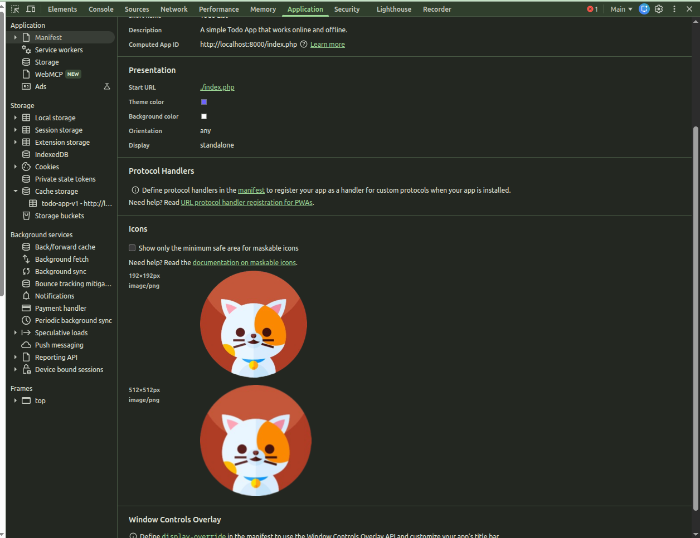
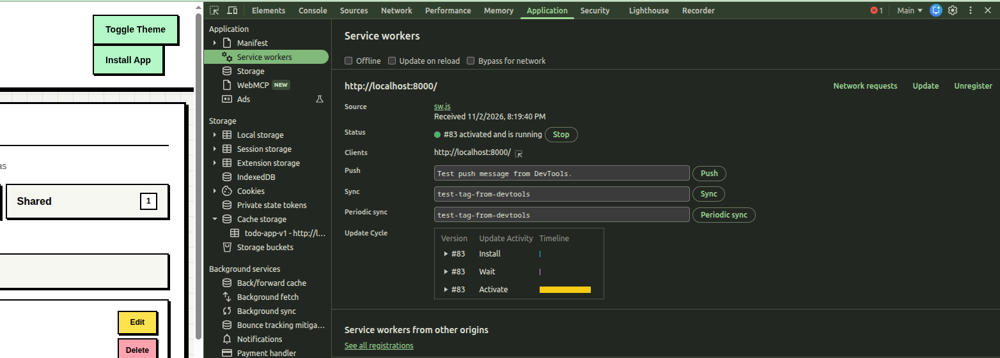
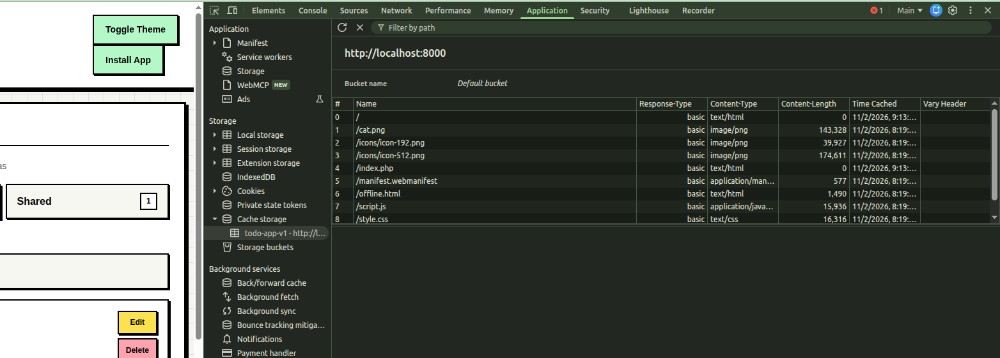
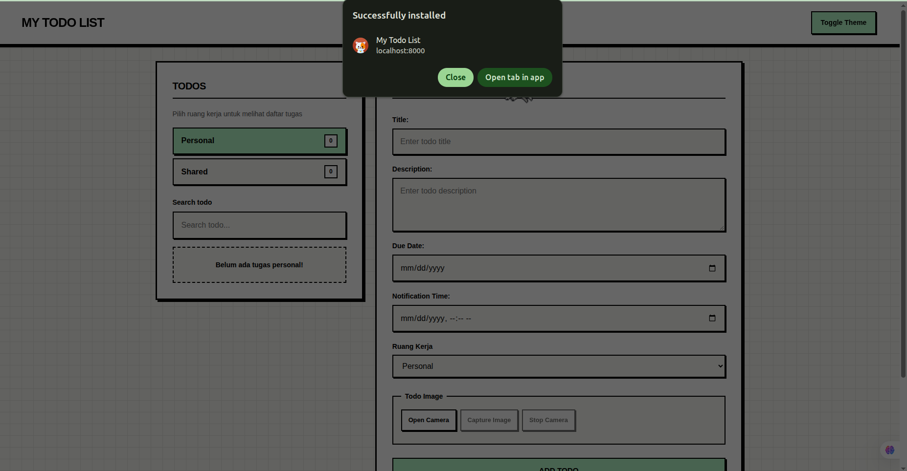
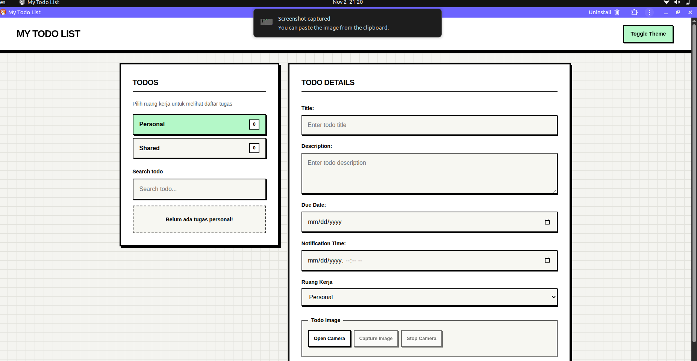
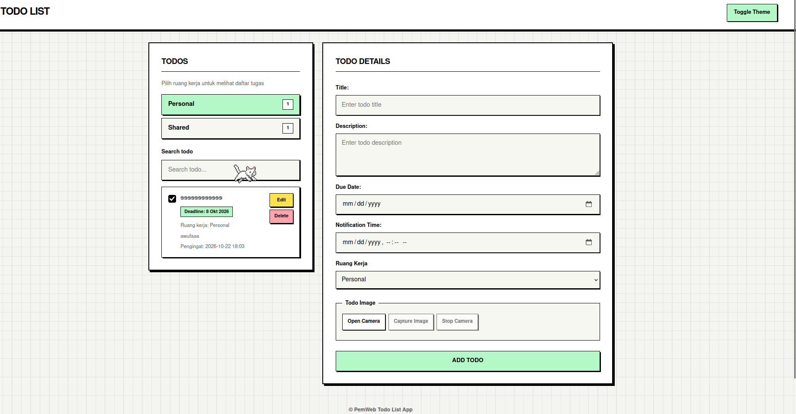

# Progressive Web App (PWA)

Aplikasi Todo telah ditingkatkan menjadi Progressive Web App (PWA) yang memungkinkan pengguna untuk menginstal aplikasi dan mengakses app shell yang tersimpan dalam memori cache bahkan tanpa koneksi internet.

## Fitur Tambahan

• Manifes Aplikasi Web yang berisi metadata dan ikon aplikasi.
• Service Worker untuk proses caching di latar belakang.
• Prechaching app shell.
• Halaman offline fallback saat jaringan tidak tersedia.
• Tombol instal menggunakan perintah instalasi bawaan dari web.
• Strategi Cache-First untuk aset statis.
• Strategi Network-First untuk navigasi HTML.
• Strategi Network-Only untuk permintaan API.

## Direktori project :

```text
│
├── composer.json
├── composer.lock
├── data.sql
├── README.md
│
├── config/
│   └── database.php
│
├── includes/
│   ├── header.php
│   ├── sidebar.php
│   ├── todo-content.php
│   └── footer.php
│
├── public/
│   │
│   ├── api/
│   │   ├── add.php
│   │   ├── bootstrap.php
│   │   ├── delete.php
│   │   ├── list.php
│   │   ├── update.php
│   │   └── upload.php
│   │
│   ├── icons/
│   │   ├── icon-192.png
│   │   └── icon-512.png
│   │
│   ├── index.php
│   ├── style.css
│   ├── script.js
│   │
│   ├── manifest.webmanifest
│   ├── sw.js
│   └── offline.html
│
```

## Caching Strategy

| Sumber Daya     | Strategi Caching                  |
| :-------------- | :-------------------------------- |
| HTML            | Jaringan Pertama (Network First)  |
| CSS             | Memori Pertama (Cache First)      |
| JavaScript      | Memori Pertama (Cache First)      |
| Gambar dan Ikon | Memori Pertama (Cache First)      |
| Manifes         | Memori Pertama (Cache First)      |
| Permintaan API  | Hanya Jaringan (Network Only)     |
| Halaman Luring  | Diprapra-penembolokan (Precached) |

## Cara Menguji PWA

1. Jalankan aplikasi menggunakan server pengembangan lokal (local development server).
2. Buka Browser.
3. Buka developer tools.
4. Masuk ke tab Application.
5. Buka Manifest dan verifikasi metadata serta ikon aplikasi.
6. Buka Service Workers dan pastikan Service Worker telah aktif.
7. Buka Cache Storage dan verifikasi bahwa sumber daya app shell telah disimpan.
8. Aktifkan mode Network Offline dari tab Network.
9. Refresh aplikasi.
10. Pastikan halaman cadangan luring (offline fallback page) muncul saat halaman utama tidak dapat diakses.

## Bukti pengujian :

• Testing manifest



• Testing service worker



• Sumber daya app shell tersimpan di Cache Storage.



• Aplikasi Todo berhasil diinstal sebagai aplikasi.





## Preview :



## Deploy link : https://if-pemrograman-web-a.github.io/5025251075_Todo-App/

---

### Nama : Muhammad Naufal Syahputra

### NRP : 5025251075
