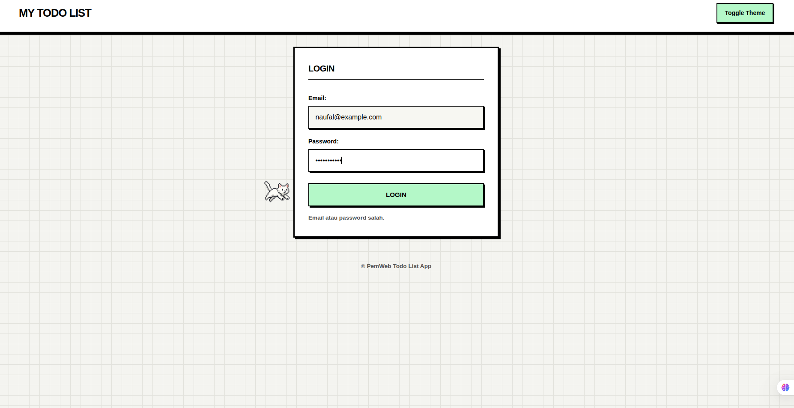
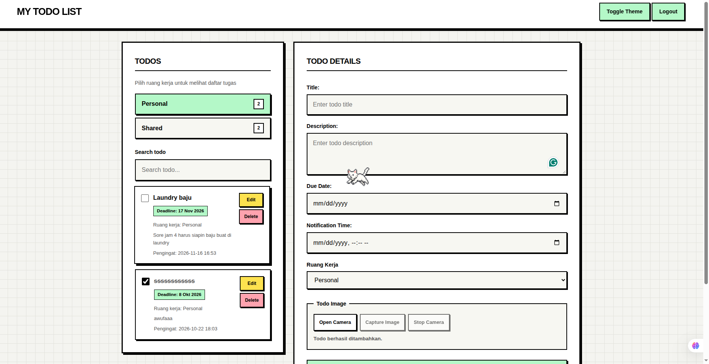
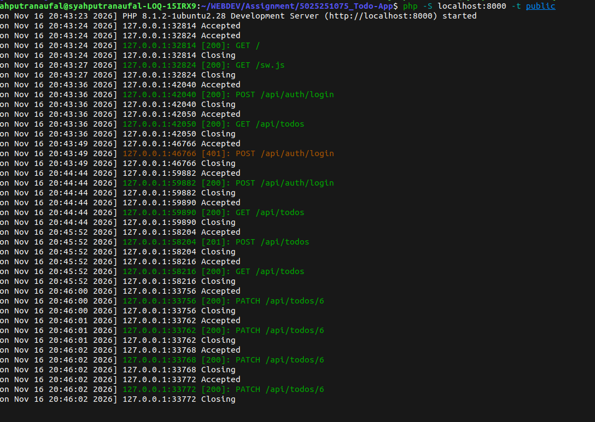

# RESTful API

## Fitur Tambahan

1. REST API dengan resource /api/todos; setiap aksi memakai method HTTP yang sesuai (GET, POST, PUT, PATCH, DELETE).
2. Response code benar (200, 201 + header Location, 204) dan response code salah untuk setiap endpoint (400, 401, 403, 404, 405, 409, 413, 415, 422, 500).
3. Format response JSON seragam, termasuk detail error per-field pada validasi (422).
4. Autentikasi JWT (HS256): login dan GET /api/auth/me; token dikirim lewat header Authorization: Bearer <token> dan punya masa berlaku.
5. Endpoint upload gambar POST /api/uploads (JPEG, maks. 5 MB).
6. Layered Architecture : front controller, Router, Controller, Validator, Repository, Response.
7. Integrasi frontend: script.js memakai REST API, form login, tombol Logout, dan otomatis kembali ke login saat token tidak valid (401).

| #   | Ketentuan                                                                       | Implementasi                                                              |
| --- | ------------------------------------------------------------------------------- | ------------------------------------------------------------------------- |
| 1   | Backend CRUD → REST API dengan method yang benar (GET, POST, PUT/PATCH, DELETE) | `GET/POST /api/todos`, `GET/PUT/PATCH/DELETE /api/todos/{id}`             |
| 2   | Response code **benar** untuk tiap endpoint                                     | `200`, `201` (+ header `Location`), `204`                                 |
| 3   | Response code **salah** untuk tiap endpoint (data error, user tidak ada, dll.)  | `400`, `401`, `403`, `404`, `405`, `409`, `413`, `415`, `422`, `500`      |
| 4   | (opsional) Autentikasi                                                          | **JWT** (HS256): `POST /api/auth/login` → `Authorization: Bearer <token>` |

## Arsitektur

```text
Browser (script.js)
   │  fetch  GET|POST|PUT|PATCH|DELETE  /api/...   + Authorization: Bearer <JWT>
   ▼
public/api/.htaccess ──► public/api/index.php   (front controller)
                              │
                              ├─ Request::capture()       baca method, path, header, body JSON
                              ├─ Router::match()          404 / 405 (+Allow) / handler
                              ├─ Jwt::verify()            401 bila token tidak ada/salah/kedaluwarsa
                              ▼
                        Controller  (AuthController · TodoController · UploadController)
                              │  validasi input → TodoValidator (422 + detail per-field)
                              │  cek kepemilikan → 403 / 404
                              ▼
                        Repository (TodoRepository · UserRepository)  ── PDO prepared statement ──► MySQL
                              ▼
                        Response::success / error / noContent  → JSON
```

> Layered
> **Router** hanya memetakan URL, **Controller** mengatur alur & status code,
> **Validator** memeriksa input, **Repository** tempat eksekusi SQL, **Response** menjaga format JSON seragam.

### Struktur direktori

```text
├── composer.json
├── data.sql
├── migration-e06.sql
├── config/
│   ├── database.php
│   └── .env.example
├── src/
│   ├── Http/
│   │   ├── Request.php
│   │   ├── Response.php
│   │   ├── Router.php
│   │   └── ApiException.php
│   ├── Auth/
│   │   └── Jwt.php
│   ├── Validation/
│   │   └── TodoValidator.php
│   ├── Repositories/
│   │   ├── TodoRepository.php
│   │   └── UserRepository.php
│   └── Controllers/
│       ├── AuthController.php
│       ├── TodoController.php
│       └── UploadController.php
├── includes/
│   ├── header.php
│   ├── sidebar.php
│   ├── todo-content.php
│   └── footer.php
└── public/
    ├── index.php
    ├── script.js
    ├── style.css
    ├── sw.js
    ├── manifest.webmanifest
    ├── offline.html
    ├── uploads/
    └── api/
        ├── index.php
        └── .htaccess
```

### Perubahan database

Hanya satu kolom: `users.password_hash VARCHAR(255) NOT NULL` (diperlukan untuk login JWT).
Tabel `todos` tidak berubah. Dua user demo memakai password `password123`.

## Daftar endpoint

Semua body request & response berformat JSON. Response sukses: `{"success":true,"message"?,"data":...}`;
response error: `{"success":false,"message":"...","errors"?:{"field":"pesan"}}`.

## Cara mencoba

### A. Lewat aplikasi (browser)

1. Buka `http://localhost:8000` → muncul form **Login**. Masuk dengan `naufal@example.com` / `password123`.
2. Tambah todo (POST), centang selesai (PATCH), **Edit** judul (PATCH), **Delete** (DELETE). Cek tab _Network_ DevTools untuk melihat method & status code.
3. **Logout** menghapus token. Token rusak/kedaluwarsa otomatis mengembalikan ke form login (respons `401`).

### B. Lewat curl (menguji status code benar & salah)

```bash
B=http://localhost:8000/api
J='Content-Type: application/json'

# Login → ambil token
TOKEN=$(curl -s -X POST $B/auth/login -H "$J" \
  -d '{"email":"naufal@example.com","password":"password123"}' | php -r 'echo json_decode(stream_get_contents(STDIN))->data->token;')
A="Authorization: Bearer $TOKEN"

# ---- Status code BENAR
curl -i $B/todos -H "$A"                                                              # 200
curl -i -X POST $B/todos -H "$A" -H "$J" -d '{"title":"Coba REST","due_date":"2026-12-01"}'   # 201 + Location
curl -i $B/todos/1 -H "$A"                                                            # 200
curl -i -X PUT   $B/todos/1 -H "$A" -H "$J" -d '{"title":"Ganti","due_date":"2026-12-02"}'    # 200
curl -i -X PATCH $B/todos/1 -H "$A" -H "$J" -d '{"is_completed":true}'                # 200
curl -i -X DELETE $B/todos/4 -H "$A"                                                  # 204 (tanpa body)

# ---- Status code SALAH
curl -i $B/todos                                                                      # 401 tanpa token
curl -i -X POST $B/auth/login -H "$J" -d '{"email":"naufal@example.com","password":"x"}'      # 401
curl -i -X POST $B/todos -H "$A" -H "$J" -d '{"title":"","due_date":"2026-02-31"}'    # 422 + detail per-field
curl -i -X POST $B/todos -H "$A" -H "$J" -d '{rusak'                                  # 400 JSON rusak
curl -i -X POST $B/todos -H "$A" -H 'Content-Type: text/plain' -d 'x'                 # 415
curl -i $B/todos/9999 -H "$A"                                                         # 404 todo tidak ada
curl -i $B/todos/abc  -H "$A"                                                         # 400 id tidak valid
curl -i $B/todos/3    -H "$A"                                                         # 403 todo personal milik Demo User
curl -i -X DELETE $B/todos -H "$A"                                                    # 405 + Allow: GET, POST
curl -i $B/foo -H "$A"                                                                # 404 endpoint tidak ada
curl -i -X POST $B/auth/register -H "$J" -d '{"name":"Naufal","email":"naufal@example.com","password":"12345678"}'  # 409
```

| Skenario              | Request                          | Status |
| --------------------- | -------------------------------- | :----: |
| Daftar todo           | `GET /api/todos`                 |  200   |
| Buat todo             | `POST /api/todos`                |  201   |
| Ubah penuh / sebagian | `PUT` / `PATCH /api/todos/{id}`  |  200   |
| Hapus                 | `DELETE /api/todos/{id}`         |  204   |
| Tanpa/invalid token   | `GET /api/todos`                 |  401   |
| Validasi gagal        | `POST /api/todos` (judul kosong) |  422   |
| Todo tidak ada        | `GET /api/todos/9999`            |  404   |
| Todo milik orang lain | `DELETE /api/todos/3`            |  403   |
| Method salah          | `DELETE /api/todos`              |  405   |

## Bukti






## Catatan

- Semua query memakai prepared statement; nama kolom pada UPDATE berasal dari whitelist validator, bukan input user.
- Password disimpan dengan `password_hash()` (bcrypt); pesan login salah sengaja sama untuk email/password agar akun tidak bisa ditebak.
- JWT hanya menerima `alg=HS256` (menolak `alg=none`), diverifikasi dengan `hash_equals`, dan punya masa berlaku (`JWT_TTL`).
- `image_path` hanya diterima jika berpola `uploads/<32 hex>.jpg` (mencegah path traversal).
- Detail error internal hanya masuk log server, client hanya menerima pesan umum (`500`).

---

### Nama : Muhammad Naufal Syahputra

### NRP : 5025251075
